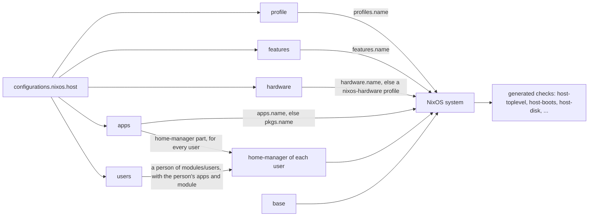

# Architecture

Not a distro: the forge where you build your own NixOS distro. Fork it, customize everything, and CI tests every machine before it reaches you: build, VM boot, install on a blank disk. This page explains how the flake is put together, and why a host is a short list of names.

## The forge rule

Upstream ships mechanisms, your fork chooses policy. Ask one question of any setting: could two forks choose it differently without either being wrong?

- **Yes: it is policy.** It lives in a named profile, feature, hardware module or app that a host lists. At most, it sits behind a `mkDefault` you override without `mkForce`.
- **No: it is a mechanism.** Every fork needs it the same way: the registry and its checks, impermanence, `forge doctor`, `update`. Only mechanisms go in `base`, which every host imports.

Your fork is not bound by that rule. Once `nix run .#init` made it yours, it sets whatever policy it wants.

## Words used here

| Word | Meaning |
|---|---|
| module | a Nix file that adds settings; NixOS merges all modules into one system |
| dendritic | the layout where every file under `modules/` is a module loaded on its own, with no import list |
| registry | every host entry of the fork, `configurations.nixos.<name>` |
| namespace | a named group a module publishes into: `features`, `apps`, `hardware`, `profiles` |
| generation | one built version of a system; the boot menu lists the recent ones |
| closure | a system and everything it needs from the Nix store |
| impermanence | `/` wiped at every boot, with the state you declare kept in `/persist` ([doctor](../how-to/doctor.md#what-the-next-boot-erases)) |

## Every file is a module

`flake.nix` hands the whole `modules/` tree to [import-tree](https://github.com/vic/import-tree), with [flake-parts](https://flake.parts). Every `.nix` file under `modules/` is a flake-parts module, imported on its own. Adding a file adds what it defines, deleting it removes it. A path segment starting with `_` is skipped.

A file does not import NixOS config. It publishes it under a name, in the namespace of its folder:

| Folder | Publishes |
|---|---|
| `modules/features/base/<tool>` | `base`, on every host |
| `modules/features/profiles/<name>` | `profiles.<name>` |
| `modules/features/<name>` | `features.<name>` |
| `modules/features/hardware/<name>` | `hardware.<name>` |
| `modules/apps/<name>` | `apps.<name>`, a NixOS part and a home-manager part |
| `modules/users/<user>` | `users.<user>`, a person: name, email, keys, apps and home config |
| `modules/hosts/<host>` | `configurations.nixos.<host>`, a registry entry |

## A host entry becomes a system

A host is a registry entry in plain values ([options.md](../reference/options.md)). Each list field is resolved in its own namespace only. A name found nowhere stops the evaluation with the names that field accepts.

- `profile` resolves to `profiles.<name>`, `features` to `features.<name>`, `hardware` to `hardware.<name>` or a [nixos-hardware](https://github.com/NixOS/nixos-hardware) profile, `apps` to `apps.<name>` or the nixpkgs package of that name.
- An app's NixOS part goes on the host, its home-manager part to every user when the host lists it, or to one user when that person or that host user lists it. No app imports another: they fit together by reading each other's options.
- A person is defined once in `modules/users/<user>`; a host's `users.<user>` creates the account on that machine, with per-machine fields only.
- A host's `specialisations` add `features`, `apps`, `hardware` and a `module` on top of the host, resolved the same way ([specialisations.md](../how-to/specialisations.md)).

### An example

The file `modules/hosts/my-laptop/default.nix` sets `configurations.nixos.my-laptop`, an entry of the **registry** (every host entry of the fork). Its `features = [ "disk" ]` names `features.disk`, which `modules/features/disk` **publishes** in the `features` **namespace**. From that one entry, the flake builds:

- `nixosConfigurations.my-laptop`, the system you switch to;
- the checks `my-laptop-toplevel`, `my-laptop-boots` and, with `disk`, `my-laptop-disk`;
- with `disk`, the package `installer-my-laptop`, its installer ISO.

`nix flake show` lists them all.

## Checks follow the registry

Nobody lists checks. Every host gets `<host>-toplevel` and a boot test, a host with `disk` an install test, and each module with a `check.nix` its own VM test. A new host or module reaches CI without touching a workflow ([reference/ci.md](../reference/ci.md#checks)).
