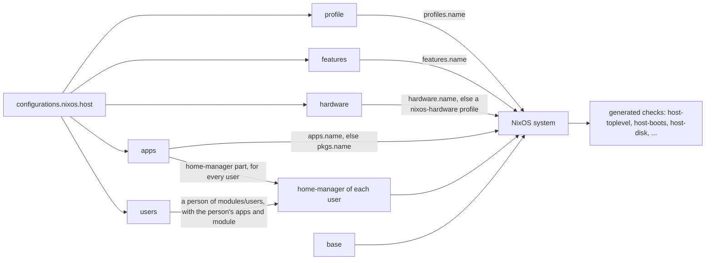

# Architecture

Not a distro: the forge where you build your own NixOS distro. Fork it, customize everything, and CI tests every machine before it reaches you: build, VM boot, install on a blank disk. This page explains how the flake is put together, and why a host is a short list of names.

## The forge rule

Upstream ships mechanisms, your fork chooses policy. Ask one question of any setting: could two forks choose it differently without either being wrong?

- **Yes: it is policy.** It lives in a named profile, feature, hardware module or app that a host lists. At most, it sits behind a `mkDefault` you override without `mkForce`.
- **No: it is a mechanism.** Every fork needs it the same way: the registry and its checks, impermanence, `forge doctor`, `forge update`. Only mechanisms go in `base`, which every host imports.

Your fork is not bound by that rule. Once `nix run .#init` made it yours, it sets whatever policy it wants.

## Words used here

| Word | Meaning |
|---|---|
| module | a Nix file that adds settings; NixOS merges all modules into one system |
| dendritic | the layout where every file under `modules/` is a module loaded on its own, with no import list |
| registry | every host entry of the fork, `configurations.nixos.<name>` |
| namespace | a named group a module publishes into: `features`, `apps`, `hardware`, `profiles` |
| generation | one built version of a system; the boot menu lists the recent ones |
| closure | a system and everything it needs from the Nix store |
| impermanence | `/` wiped at every boot, with the state you declare kept in `/persist` ([doctor](../how-to/doctor.md#what-the-next-boot-erases)) |

## Every file is a module

`flake.nix` hands the whole `modules/` tree to [import-tree](https://github.com/vic/import-tree), with [flake-parts](https://flake.parts). Every `.nix` file under `modules/` is a flake-parts module, imported on its own. Adding a file adds what it defines, deleting it removes it. A path segment starting with `_` is skipped.

A file does not import NixOS config. It publishes it under a name, in the namespace of its folder:

| Folder | Publishes |
|---|---|
| `modules/features/base/<tool>` | `base`, on every host |
| `modules/features/profiles/<name>` | `profiles.<name>` |
| `modules/features/<name>` | `features.<name>` |
| `modules/features/hardware/<name>` | `hardware.<name>` |
| `modules/apps/<name>` | `apps.<name>`, a NixOS part and a home-manager part |
| `modules/users/<user>` | `users.<user>`, a person: name, email, keys, apps and home config |
| `modules/hosts/<host>` | `configurations.nixos.<host>`, a registry entry |

## A host entry becomes a system

A host is a registry entry in plain values ([options.md](../reference/options.md)). Each list field is resolved in its own namespace only. A name found nowhere stops the evaluation with the names that field accepts.

- `profile` resolves to `profiles.<name>`, `features` to `features.<name>`, `hardware` to `hardware.<name>` or a [nixos-hardware](https://github.com/NixOS/nixos-hardware) profile, `apps` to `apps.<name>` or the nixpkgs package of that name.
- An app's NixOS part goes on the host, its home-manager part to every user when the host lists it, or to one user when that person or that host user lists it. No app imports another: they fit together by reading each other's options.
- A person is defined once in `modules/users/<user>`; a host's `users.<user>` creates the account on that machine, with per-machine fields only.
- A host's `specialisations` add `features`, `apps`, `hardware` and a `module` on top of the host, resolved the same way ([specialisations.md](../how-to/specialisations.md)).

### An example

The file `modules/hosts/my-laptop/default.nix` sets `configurations.nixos.my-laptop`, an entry of the **registry** (every host entry of the fork). Its `features = [ "disk" ]` names `features.disk`, which `modules/features/disk` **publishes** in the `features` **namespace**. From that one entry, the flake builds:

- `nixosConfigurations.my-laptop`, the system you switch to;
- the checks `my-laptop-toplevel`, `my-laptop-boots` and, with `disk`, `my-laptop-disk`;
- with `disk`, the package `installer-my-laptop`, its installer ISO.

`nix flake show` lists them all.

## Layout of `modules/`

One folder per tool, never a loose `.nix` file at layer level (`flake/helpers/` excepted):

- `flake/`: the wiring, the registry, the checks, the installer, the `init` and `upstream` wrappers, the dev shell, the CI scripts, `rust/` (which builds `crates/`) and `helpers/`.
- `features/`: `base/` (`nix`, `home-manager`, `impermanence`, `resolved`, `journald`, `doctor`, `update`, `forge`: mechanisms every fork needs, their choices set with `mkDefault`), `profiles/` (`desktop`, `laptop`, `server`, `pi`), `hardware/`, and one folder per feature ([features.md](../reference/features.md)). `disk` has the sub-folders `snapshots/` and `beside-windows/`.
- `apps/`: everything a user runs, with its config ([apps.md](../reference/apps.md)).
- `users/` (one folder per person) and `hosts/` (one per machine): they belong to the fork.

Helpers live in `config.helpers`, one file per topic under `modules/flake/helpers/`, read with `inherit (config.helpers) <name>;`. App values go through `helpers.mkDefaults`, so a user overrides them without `mkForce`; lists meant to be extended stay plain.

## Namespaces

`modules/flake/hosts/namespaces.nix` declares one flake-level option per registry field:

- `base`: one module, on every host. Every `features/base/<tool>` adds to it.
- `profiles.<name>`, `features.<name>`, `hardware.<name>`: NixOS modules. Each is wrapped with the `key` `nixos-forge/<field>/<name>`, so NixOS imports it once however many times it is named. <!-- docs-check: allow nixos-forge -->
- `apps.<name>`: a `nixos` part and a `homeManager` part, each imported with `_class` set to its part, so a home-manager module put in a `nixos` part stops the evaluation.

Several files may write to the same name, and the module system merges them: `features/disk/snapshots`, a sub-folder of the feature it extends, adds to `disk`; an app's `default.nix` and `home.nix` both define it. A name published by two namespaces stops the evaluation (the `flake-modules` check).

`flake.modules.nixos.<name>` and `flake.modules.homeManager.<name>` are outputs only, for other dendritic flakes to import. `modules/flake/flake-parts/modules.nix` maps them from `base`, the three namespaces and the app parts some file defines (an app with no `nixos` part is absent from `flake.modules.nixos`). Nothing in the flake reads them.

## How names resolve

The registry options live in `modules/flake/hosts/options.nix`. Names are lists, never `enable` booleans, and become imports at the flake-parts level, in the registry's `config.module`. The registry sets `nixpkgs.hostPlatform` from `system`. A host name has 1 to 63 letters, digits, `-` and `_`, and starts and ends with a letter or a digit.

- An app's two parts go through `helpers.appPart` with the `key` `nixos-forge/apps/<name>/<part>`, so an app named by both the host and a person is imported once (the `apps-once` check). <!-- docs-check: allow nixos-forge -->
- A name of `apps` that is not an app is the nixpkgs attribute path `pkgs.<name>`, with its unfree name allowed: `apps = [ "docker" ]` installs `pkgs.docker`. Tools with nothing to configure (`ripgrep`, `fd`, `jq`) stay nixpkgs names, not apps.
- An unknown name stops the evaluation naming the field. For `profile`, `features` and `hardware` it lists that namespace alone; for `apps` it lists the configured apps and says any nixpkgs attribute path works; for `users` it lists the people of `modules/users`. The `wrong-namespace` check proves these messages, one of them from a variant.
- A host's `specialisations.<name>` takes `features`, `apps`, `hardware` and `module`, resolved by the same code (`selection` in `options.nix`) into `specialisation.<name>.configuration`, which also writes the name to `/etc/specialisation`. A variant inherits the host only, never another variant. Lists merge, so a variant adds to the host's and the person's `apps` and cannot remove one. `forge update` (through `nh`) and `auto-upgrade` in `switch` mode read `/etc/specialisation` to stay on the running variant; the `specialisations` check switches a host to a variant and back.

## Apps stand alone

No app imports another app or a feature. An app keeps only what it cannot start or do its core job without: `hyprland` brings uwsm, its portal, a polkit agent, fonts and its binds. Every choice (terminal, launcher, bar, notifications, lock screen, login manager, prompt, editor, pager) is an app or a feature the host or the person lists.

An app fits its neighbours by reading their home-manager options (`config.programs.fuzzel.enable`), never by importing them. Hyprland binds the launcher, clipboard and lock keys only when `fuzzel` and `lock` are listed, and its terminal key runs `xdg-terminal-exec`, whose default `kitty` registers ([desktop.md](../reference/desktop.md)). The `hyprland-alone` check proves it.

## People and accounts

People are the flake-level `users.<name>` of `modules/flake/hosts/users.nix`. `modules/users/<user>/default.nix` sets `fullName`, `email`, `sshKeys`, `apps` (`[ ]` by default, installed on every host that gives the person an account) and `module`, the person's own home-manager config. `module` is wrapped with the `key` `nixos-forge/users/<user>` and `_class = "homeManager"`; several files of the folder may each set part of it. <!-- docs-check: allow nixos-forge -->

A host's `users.<user>` holds per-machine fields only (`admin`, `groups`, `apps` added to the person's) and creates the account: `wheel` when `admin`, the password from `/persist/passwords/<user>` with persistence, `test` in the VM. Its home-manager config imports the host's `apps`, the person's and the host user's, then the person's `module`. zsh is the login shell when one of those lists names `zsh`. A host naming a person without a `modules/users/<user>` folder stops the evaluation with the known people.

## Rust workspace

`crates/` is a Cargo workspace built by `modules/flake/rust/` with [crane](https://github.com/ipetkov/crane) (the `crane` input, which lanzaboote follows) and the Rust toolchain of the locked nixpkgs. `buildDepsOnly` runs once and its `cargoArtifacts` are shared by `packages.forge` and the Rust checks ([ci.md](../reference/ci.md#checks-of-the-rust-code)). The source is filtered to `crates/`, so a docs change rebuilds no Rust.

| Crate | Holds | Reaches |
|---|---|---|
| `forge` (`crates/forge`) | the `forge` command and the lib its ports live in | every host, through the base tool `forge`; `packages.forge` is built with `-p forge` |
| `forge-ci` (`crates/forge-ci`) | the CI scripts `plan`, `build`, `report`, `promote`, `badges`, `flaky`, `flaky-plan`, `flaky-report`, `reproducibility`, on top of the `forge` lib's ports | no host; each `packages.ci-*` wraps `forge-ci <name>` through `helpers.forgeCommand`, as `init` and `upstream` wrap `forge` |
| `forge-apps` (`crates/forge-apps`) | `stow-dotfiles` and `upgrade-notify`, the programs of the `stow` and `upgrade-notify` apps | `packages.forge-apps`, wrapped by each app's module, so only a host listing the app carries it |

`forge` has built-in commands and runs any other `forge <name>` as the first `forge-<name>` found, after checking its contract ([forge.md](../reference/forge.md)). The base tool `forge` wraps it with the `bin` of every package of `forge.commands` in `FORGE_COMMANDS_PATH`, the `bin` of the internal `forge.runtimeInputs` before `PATH`, and the internal `forge.environment` variables. The `doctor` base tool sets `FORGE_DOCTOR_CONFIG` to its system's settings and the `dual-boot` feature `FORGE_DUAL_BOOT_CONFIG`, so a variant's `forge` reads its own. `forge install --beside-windows` runs a `forge` built for the target, `system.build.installBesideWindows`, with `FORGE_BESIDE_WINDOWS_CONFIG`. `base-forge` proves the contract in a VM, `base-doctor` the doctor checks a fork adds.

## Checks follow the registry

Nobody lists checks. Every host gets `<host>-toplevel` and a boot test, a host with `disk` an install test, and each module with a `check.nix` its own VM test. A new host or module reaches CI without touching a workflow ([reference/ci.md](../reference/ci.md#checks)).
