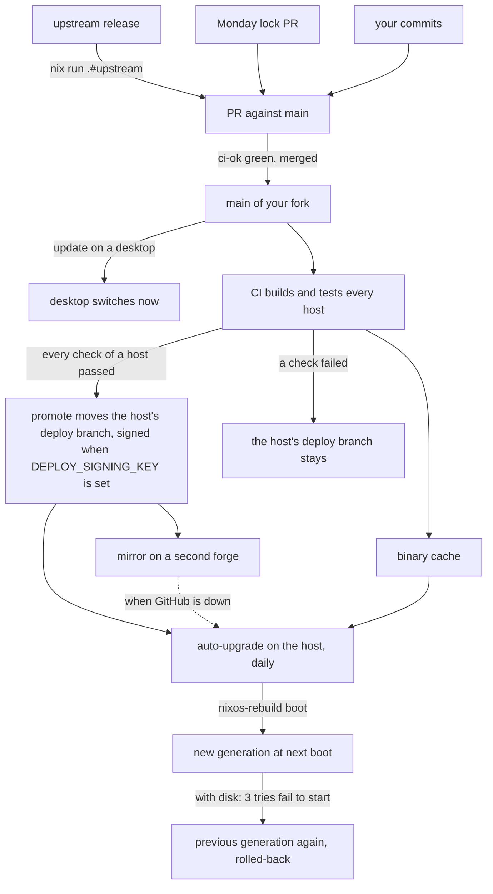

# Updates

How a change reaches your machines, from upstream or from you, without ever skipping CI. This page is the home of the auto-upgrade flow; other pages link here.

In short:

1. Every Monday your fork gets a PR with new inputs, and you merge upstream's releases when you choose.
2. CI proves every change on every host.
3. Each machine then pulls your fork: by hand with `forge update`, or on its own with `auto-upgrade`.

A **generation** is one built version of the system; the boot menu lists the recent ones, so you can always boot the previous one.



## Your fork follows upstream

Upstream is the original repository your fork came from. Your fork decides when it takes upstream's releases. In your checkout, with no uncommitted change and on any branch, run:

```console
$ nix run .#upstream
```

What it does, step by step:

1. Reads upstream's latest release tag (`git ls-remote`, no GitHub login needed). A fork whose `origin/main` already holds it gets `Already up to date with <tag>.`
2. Prints what changed since your last merge: the breaking changes first (a `!` commit or a `BREAKING CHANGE` footer), then the new lines of upstream's `CHANGELOG.md`.
3. Asks `Prepare branch chore/sync-upstream-<tag>? [y/N]` (`--yes` skips the question).
4. On yes, creates that branch from `origin/main` and merges the tag with a merge commit. It never starts from the branch you are on, so unreleased work on `develop` stays out.
5. Pushes it to `origin` and opens a PR against `main` with `gh` when it is logged in. Otherwise it prints the `gh pr create --repo <owner>/<repo>` command to run. The PR body lists the upstream commits it merges (`git log --oneline` from `origin/main` to the tag), then the breaking changes and the changelog.

Upstream is the argument (a git URL or a GitHub `owner/repo`), else your `upstream` remote, else the URL written at the top of `modules/flake/upstream/upstream.sh`.

It never merges into `main` on its own: upstream's code reaches your machines only once you have read the diff. Adapt your hosts on the branch if needed and wait for `ci-ok`. Then merge with a merge commit, never a squash, so the next merge starts from there.

### If the merge conflicts

`nix run .#upstream` names the conflicting files, aborts the merge, deletes the branch, returns to where you started and exits 1. Merge by hand instead, as its error says:

1. Create the branch from `origin/main` and merge the tag:

   ```sh
   git switch -c chore/sync-upstream-<tag> origin/main
   git merge --no-ff <tag>
   ```

2. Resolve the conflicts and commit.
3. Push the branch and open its PR against `main`.

A fork that shares no history with upstream (made by copying its files) gets git's `refusing to merge unrelated histories` and the same clean exit.

The conflict that comes back is a release editing the examples your fork removed (its hosts and person under `modules/hosts` and `modules/users`). git reports a modify/delete conflict. Read their diff, which shows what a new field looks like, then keep them deleted (`git rm` them, then commit the merge). Upstream keeps `modules/hosts` and `modules/users` minimal, so other conflicts stay rare while your own config lives there.

Only upstream publishes releases (`release` is skipped in forks, [releases.md](../maintenance/releases.md)), so `CHANGELOG.md` and the version files never conflict. Upstream tries every change as an upgrade of the previous version before it releases it ([ci.md](../maintenance/ci.md#upgrades-from-the-previous-release)).

### Weekly PRs

| Workflow | When | What it does |
|---|---|---|
| `update-flake-lock` | Monday 06:00 UTC | opens a PR updating `flake.lock`, which merges itself once `ci-ok` is green; it only moves inputs (nixpkgs, home-manager, ...) to newer revisions of the same sources |
| `sync-upstream` | Monday 07:00 UTC, only when the repository variable `SYNC_UPSTREAM` is `true` | runs `nix run .#upstream -- --yes` on `main` of your fork; `UPSTREAM` (`owner/repo`) points it at another upstream repository |

Set `SYNC_UPSTREAM` in Settings, Secrets and variables, Actions, Variables. Without it, `sync-upstream` does nothing, even by hand. Both workflows need the bot App and the settings of [ci.md](../how-to/ci.md#turn-ci-on-in-your-fork).

## The edit loop

How a change of yours reaches the machine you sit at, then the others:

1. **Edit** your checkout (the host's `flake`, such as `~/nixos`). Tracked files are read as they are on disk, committed or not. A new file must be `git add`ed first, or the flake does not see it.
2. **Try** it with `nh os test`. It builds and switches the running system, but the boot menu keeps its default, so a reboot comes back to what you had.
3. **Switch** with `nh os switch`. The change is live with no reboot, and the boot menu now starts it by default. Reboot only for a new kernel, initrd, disk encryption or boot loader.
4. **Commit and push**, so your other machines follow with `forge update` or `auto-upgrade`, and CI proves the change on every host.

`forge update` pulls your fork first (`git pull --ff-only`). It stops when an incoming commit touches a file you edited, so use it once your edits are committed.

Every `nh os switch` or `forge update` leaves a generation in the boot menu: pick the previous one at boot to undo a change that breaks the machine. `nh os test` leaves none: a reboot returns to the current default.

## A machine follows your fork

Tell the host where it updates from, in its registry entry:

```nix
configurations.nixos.my-laptop.flake = "/home/<you>/nixos";
```

**A checkout on the machine** (desktops, laptops): run `forge update`. It pulls your fork with `git pull --ff-only`, refusing a checkout that has diverged. Then it runs `nh os switch`, which builds, shows the package diff and switches. Extra arguments go to nh (`forge update --ask`). `nh os switch` alone works too, since `flake` is also its default.

The checkout survives a reboot on its own:

- in `/home/<you>/`, it is kept in `/persist/home/<you>` when the host has `wipe-home`, owned by you;
- elsewhere on `/` (such as `/etc/nixos`), it is kept in `/persist`, owned by root;
- a checkout that is also your `stow.directory` is kept once, by `stow`.

Do not list it again in your own `home.persistence` or `environment.persistence`: impermanence refuses a path declared twice. The build also stops, naming `flake`, unless the path:

- is a directory of its own;
- is written without `.`, `..` or a trailing `/`;
- is not `/`, `/home`, `/nix`, `/persist` or your home itself.

**A flake reference** (servers, Raspberry Pi): set `flake = "github:<owner>/<repo>"` and run `forge update`. It builds your fork's `main` with no checkout to pull.

## A machine upgrades on its own

Add the `auto-upgrade` feature to a host to have it follow the version CI validated for it, while you sleep.

### The flow

1. **CI picks the version.** Once every check of a host passes on `main`, CI moves the `deploy/<host>` branch of your fork to that commit, with the token of the bot App ([ci.md](../how-to/ci.md#validated-versions-per-machine)). Without the App, no `deploy/<host>` branch ever exists and the machine stays `waiting`.
2. **The machine fetches it daily.** Every day from 04:00, randomized over 45 minutes, `auto-upgrade.service` runs `forge auto-upgrade`, which fetches that branch and builds it; run it by hand as root to try it now ([forge.md](../reference/forge.md)). A machine that was off catches up at its next start, and a run started while another one is still going stops without changing anything.
3. **It installs it for the next boot.** It applies the new version with `nixos-rebuild boot`: the machine keeps running what it runs, and starts the new version at the next reboot. Set `autoUpgrade.operation = "switch"` in the host's `module` to start it right away.
4. **A bad version rolls back.** On a host with `disk`, a new version that does not start is abandoned on its own after 3 tries ([install.md](../tutorials/install.md#going-back-to-the-previous-generation)).

On a Raspberry Pi (`pi` profile), it builds nothing itself (`autoUpgrade.allowLocalBuild = false`). It substitutes everything from the binary cache and its remote builders, so a Pi upgrades only to a version CI built and cached (`<host>-toplevel`). A version the cache does not hold yet waits for the next run.

### Sources

The host's `flake` is the first source:

- **A flake reference**: a plain `github:<owner>/<repo>` or `git+https://...`, without a query such as `?dir=`.
- **A checkout**, through its `origin` remote; an SSH remote is turned into its https URL. A checkout with no `.git` yet goes straight to the mirrors.

A checkout must belong to an admin. `auto-upgrade` trusts its remote only when root or an admin (`wheel`) owns the checkout, its `.git` folder and `.git/config`, and no one outside root and `wheel` can write to them. Otherwise any user could point it at a repository of their own. `.git` must be a folder, not a file or a link as in a worktree. The owner must be a local account: `auto-upgrade` reads its name from `/etc/passwd` and the members of `wheel` from `/etc/group`, so an owner known only through LDAP or another NSS source counts as an outsider and the checkout is not trusted.

When that source is down, it tries the host's `mirrors` in order:

```nix
configurations.nixos.my-server = {
  flake = "github:<owner>/<repo>";
  mirrors = [ "https://codeberg.org/<owner>/<repo>.git" ];
};
```

The `mirror` workflow keeps such a mirror up to date: it pushes `main` and every `deploy/<host>` there after each change. Set the repository variable `MIRROR_URL` and the secret `MIRROR_TOKEN` ([ci.md](../how-to/ci.md#mirror-to-a-second-forge)), then list that same URL in the `mirrors` of each host.

Source rules:

- A mirror or an `origin` remote over `http://` or `git://` is refused: anyone on the network path could then choose what the machine builds.
- It fetches over https without credentials. An `origin` over ssh is fetched at its https URL, so a private fork needs a mirror the machine can read without a login, or a mirror over ssh.
- A mirror over ssh (`ssh://` or `user@host:path`) is fetched as root with `HOME=/root`. It needs a root SSH key that survives a reboot, such as `/root/.ssh` in `environment.persistence."/persist"` or a sops-nix secret at `/root/.ssh/id_ed25519`, and the mirror's host key in `programs.ssh.knownHosts`. The build warns about every ssh mirror as a reminder.

Without `signers`, every source, `mirrors` included, is trusted as much as the fork itself: anyone who can push `deploy/<host>` to one of them decides what root builds on the machine. With `signers`, a source can only withhold a version ([below](#signed-deploy-commits)). On GitHub, protect `deploy/*` with a ruleset whose only bypass is the bot App ([ci.md](../how-to/ci.md#turn-ci-on-in-your-fork)). On a mirror, give push access to the `MIRROR_TOKEN` account alone.

### Outcomes

It never replaces a system it cannot place in the history of `deploy/<host>`. Each run ends with one outcome:

| Outcome | When | What to do |
|---|---|---|
| `upgraded` | a newer validated commit was built | nothing, it applies at next boot |
| `up-to-date` | `deploy/<host>` is the running commit, or is installed and applies at next boot | nothing, or reboot |
| `waiting` | CI has not validated a version for this host yet (a source answered without `deploy/<host>`), or the cache lacks that version and local builds are off | nothing, the next run retries. If it lasts, check that the bot App is set up ([ci.md](../how-to/ci.md#turn-ci-on-in-your-fork)), since without it `promote` never runs, and that the host's checks pass |
| `rolled-back` | the version installed for next boot spent its tries and the machine went back to the previous generation; auto-upgrade does not install it again while `deploy/<host>` points to it | fix it and push: CI validates the fix, and a newer `deploy/<host>` is installed as usual |
| `refused` | the system running or installed for next boot is not in the history of `deploy/<host>` (uncommitted changes, a commit not pushed yet, or a pointer moved back by a force push), the checkout is not owned by an admin, or, with `signers`, no source serves a commit signed for this host ([below](#signed-deploy-commits)) | commit and push, and let CI validate it; or `chown` the checkout; or check the `DEPLOY_SIGNING_KEY` secret of the fork |
| `unreachable` | no source answered within 60 seconds | check the network or the mirrors; the machine stays on its version |
| `failed` | the build or the switch failed | `journalctl -u auto-upgrade` |

The last run is in `/var/lib/auto-upgrade/state.json`: outcome, from and to commits, source, message, and the package diff summary from `nvd`. Each run adds one line to `/var/lib/auto-upgrade/history.tsv`. Both survive reboots.

`nixos-version --configuration-revision` prints the commit the running system was built from, with a `-dirty` suffix when the tree had uncommitted changes. When CI signs its promotions, that commit is the promotion commit `deploy/<host>` points to, not the commit of `main` it validated; the same goes for the from and to commits. `git log -1 <commit>` in your fork names the commit of `main` in its subject (`deploy <host>: checks passed for <short sha>`), and that commit is its last parent.

### Signed deploy commits

Whoever can push `deploy/<host>` to one of the machine's sources decides what it builds as root: a leaked bot token, a mirror's forge, or its `MIRROR_TOKEN`. With `signers` set, a machine applies only a commit CI signed for it:

```nix
configurations.nixos.my-server = {
  flake = "github:<owner>/<repo>";
  signers = [ "ssh-ed25519 AAAAC3NzaC1lZDI1NTE5AAAA... deploy" ];
};
```

CI signs each promotion with the SSH key in the secret `DEPLOY_SIGNING_KEY` of the fork's `deploy` environment ([ci.md](../how-to/ci.md#sign-the-deploy-branches)). Rather than moving `deploy/<host>` to the commit of `main`, it creates a new commit with:

- the same tree;
- the previous promotion and that commit of `main` as parents;
- the subject `deploy <host>: checks passed for <short sha>`;
- its signature.

`nix run .#init` generates that key pair for a new fork, before it writes any host:

- it writes the public key in the `signers` of the hosts it writes or keeps;
- it saves the private key in a file readable by you alone, outside the repository (under `$XDG_RUNTIME_DIR` when set);
- it prints only that file's path, with `gh secret set DEPLOY_SIGNING_KEY --env deploy < <file> && shred -u <file>` and the way through the GitHub web page, never the key itself.

For a fork made before, generate one yourself (`ssh-keygen -t ed25519 -N "" -C deploy -f deploy`). Store `deploy` in the secret, delete it, and put the content of `deploy.pub` in the `signers` of your hosts.

After each fetch, `auto-upgrade` checks the commit with `git verify-commit`, trusting only the keys of `signers` and no GPG or X.509 keyring. Then it checks that the subject names this host. A source that fails is skipped with its reason, and the next one is tried:

- `unsigned`;
- `not signed with an SSH key`;
- `signed by a key not in update.signers`;
- `signature invalid` (changed after signing);
- `signed for another host`.

When no source serves a commit that passes, the run ends `refused`, naming each source and its reason. It builds nothing and leaves the machine on its version. There is no fallback to an unsigned commit.

The history check above compares the commits of `main` that promotions carry: their last parent, or the commit itself when it is not a promotion. The one served must be the one the machine runs or a later one. So:

- an older signed promotion replayed by a source is refused;
- a deploy branch deleted or reset by hand, then promoted again from a later commit of `main`, is applied;
- a source that keeps serving an old signed commit leaves the machine `up-to-date` on it, and `forge doctor` warns once the last success is more than 14 days old.

Without `signers`, the machine applies whatever its sources serve, signed or not, and `forge doctor` shows a `Signed deploys` warning at every run.

To change the key, add the new public key to `signers` and let the machines upgrade once, still signed by the old key. Then replace the secret and remove the old key from `signers`. A machine learns its keys only from its own configuration: revoke a leaked key by rebuilding each machine with the key removed, not from CI.

### Know what it did

`sudo forge doctor` reads that state ([doctor.md](../how-to/doctor.md)):

- its `Upgrades` line says when the last run upgraded and what it changed, or since when the machine is up to date;
- it warns with the reason when the last run was `refused`, `unreachable`, `waiting`, `failed` or `rolled-back`, or when the last success is more than 14 days old;
- its `Boot` line warns when the newest generation spent its tries and the machine runs an older one;
- `forge doctor --history` prints the last 10 runs.

The `upgrade-notify` app shows a desktop notification for each upgrade, for a user whose apps include it (the host's, the person's or the host user's). Its user service runs when a graphical session starts:

- When the last run says `upgraded` and that upgrade was not announced yet, it shows a `System updated` notification with the package diff summary.
- It adds `Restart to use it.` while the machine does not run the upgraded commit yet (`operation = "boot"`).
- It remembers the upgrade (its time and commit) in `~/.local/state/upgrade-notify/seen`, persisted with `wipe-home`, so each upgrade is announced once, reboots included.
- It reads the local state only and makes no network call. When no notification daemon answers, it ends without failing and announces the upgrade at the next session.
